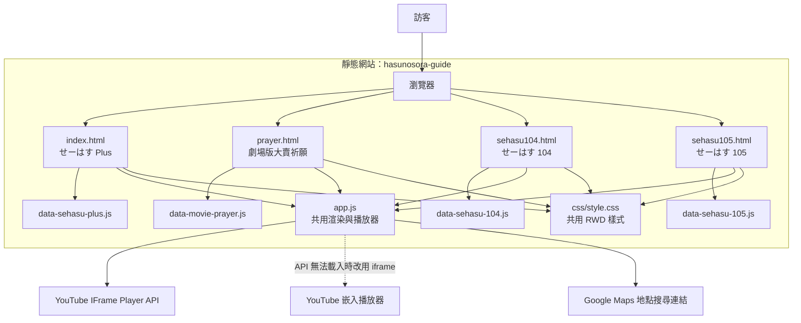

# 蓮ノ空聖地巡禮與外景美食指南

以《蓮ノ空女学院スクールアイドルクラブ》節目外景為主題的靜態網站，整理拍攝地點、同款美食與影片時間軸。點選時間碼即可在頁面底部的播放器跳到對應場景。

## 頁面導覽

| 頁面 | 內容 |
| --- | --- |
| [`index.html`](./index.html) | せーはす Plus 外景與美食 |
| [`prayer.html`](./prayer.html) | 劇場版大賣祈願「蓮ノ三連華」甜點咖啡廳對談 |
| [`sehasu104.html`](./sehasu104.html) | せーはす 104 金澤外景與美食 |
| [`sehasu105.html`](./sehasu105.html) | せーはす 105 Unit 旅與金澤能登外景 |

各頁面共用導覽列，可在四個主題之間切換。

## 使用方式

網站為純 HTML、CSS、JavaScript 靜態網站，無需建置或安裝相依套件。部署至靜態網站主機後，從 `index.html` 開始瀏覽；在本機也可使用任何靜態檔案伺服器預覽。

- 點選時間碼播放對應片段；點選縮圖可從影片開頭播放。
- 播放器固定在畫面下方，可縮小、關閉，或定位回目前播放的時間軸。
- 點選 YouTube 圖示可在 YouTube 開啟影片；已知拍攝地點提供 Google Maps 連結。
- 使用「只看美食片段」篩選有美食標記的集數。

## 專案結構

```text
hasunosora-guide/
├── index.html                 # せーはす Plus
├── prayer.html                # 劇場版大賣祈願
├── sehasu104.html             # せーはす 104
├── sehasu105.html             # せーはす 105
├── css/
│   └── style.css              # 全站共用 RWD 樣式
├── js/
│   ├── app.js                 # 導覽列、頁面渲染與共用播放器
│   ├── data-sehasu-plus.js    # せーはす Plus 集數資料
│   ├── data-movie-prayer.js   # 劇場版大賣祈願資料
│   ├── data-sehasu-104.js     # せーはす 104 集數資料
│   └── data-sehasu-105.js     # せーはす 105 集數資料
└── README.md                  # 專案說明
```

### 頁面與共用程式的關係



每個 HTML 頁面載入自己的集數資料、共用的 `app.js` 與 `css/style.css`。頁面初始化後由共用程式產生導覽列和集數卡片；播放器則在使用者開始播放時建立。若 YouTube IFrame Player API 無法及時載入，會改用一般 iframe 嵌入播放。

## 集數資料維護

請編輯對應的 `js/data-*.js` 資料檔。地點可使用 `locations` 陣列列出多個拍攝地點；有可用的 Google Maps 搜尋關鍵字時填入 `mapQuery`，地點尚未公開時填 `null`。既有的單數 `location` 格式仍相容。

```js
locations: [
  { name: "拍攝地點 A", mapQuery: "拍攝地點 A" },
  { name: "拍攝地點 B", mapQuery: null }
]
```

集數資料亦可包含 `videoId`、`foods` 與 `timeline`。時間軸項目的 `time` 為顯示時間；可選填 `sec` 作為影片跳轉秒數，未填時會由 `time` 換算。美食片段可用 `isEating: true` 標記，並以 `foodTitle` 提供品項名稱。
